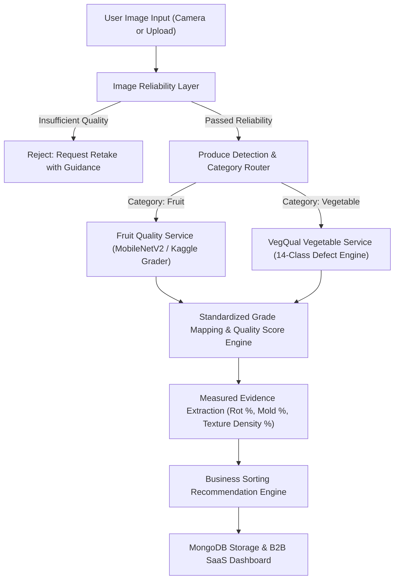

# FreshGrade AI — Fruit & Vegetable Quality Intelligence Platform

> **Tagline**: *"Turn Produce Images Into Actionable Quality Insights."*

FreshGrade AI is a unified, smartphone-first AI produce inspection platform designed for farmers, wholesalers, supermarkets, exporters, and food-processing enterprises. It standardizes visual quality inspection across both **Fruits** and **Vegetables** to reduce food waste, optimize sorting operations, and provide transparent B2B grade recommendations.

---

### 📚 Datasets Integrated

1. **Kaggle Fruits Fresh and Rotten Dataset** ([`sriramr/fruits-fresh-and-rotten-for-classification`](https://www.kaggle.com/datasets/sriramr/fruits-fresh-and-rotten-for-classification)):
   - ~13,500 produce images across 6 benchmark classes (`freshapples`, `freshoranges`, `freshbananas`, `rottenapples`, `rottenoranges`, `rottenbananas`).
2. **VegQual 14-Class Vegetable Dataset** ([Nature Scientific Data / Figshare](https://github.com/tarekrahamn/VegQual)):
   - 4,736 annotated images across 7 vegetable types (`Tomato`, `Potato`, `Bitter Gourd`, `Pointed Gourd`, `Onion`, `Capsicum`, `Brinjal`).
3. **SMS Fruit Quality Dataset**:
   - Adapted from Fruits-360 for MobileNetV2 fruit quality grading.

---

## 🌟 Key Features & Original Contributions

- **Unified Produce Inference Architecture**: Single API & inference pipeline (`InferenceService`, `ProduceModel`, `QualityModel`) that routes dynamically between fruit and vegetable ML models.
- **Image Reliability Layer**: Pre-inspection image quality check validating blur (Laplacian variance), illumination, contrast, and framing before running model inference.
- **Stem Calyx & Specular Glare Masking**: Filters green calyx/stem leaves ($35 \le H \le 85$) and specular reflections ($V > 235$) to ensure stem leaves on fresh tomatoes/eggplants are not misread as surface lesions.
- **Standardized A/B/C Grade Mapping**:
  - **Grade A**: High visible quality (Fresh, score 80–100)
  - **Grade B**: Moderate visible defects (Adulterant/Defective, score 50–79)
  - **Grade C**: Significant defects / decay (Rotten/Damaged, score <50)
- **Measured Empirical Evidence & Reasoning**: Calculates transparent rot ratio %, discoloration %, lesion texture density %, colour score, and surface smoothness.
- **Batch-Level Inspection & Aggregation**: Create produce batches (e.g. `TOM-2026-001`), upload multiple items, track Grade A/B/C distribution counts, and view batch-level quality trends.
- **Operational Business Recommendations**: Provides channel routing recommendations (Premium Retail, Standard Local Retail, Industrial Food Processing) without unsubstantiated financial claims.
- **Smartphone-First B2B SaaS Interface**: Modern, responsive UI featuring live browser camera capture, dropzone upload, demo mode, and an interactive analytics dashboard.

---

## 🏗️ System Architecture



---

## 🚀 Quick Start & Installation

### 1. Prerequisites
- Python 3.10+ (Tested on Python 3.14)
- Google Chrome, Safari, or Microsoft Edge (for camera preview)

### 2. Install Dependencies
```bash
pip install fastapi uvicorn opencv-python pillow pydantic pymongo matplotlib requests jinja2 python-multipart httpx pytest
```

### 3. Run Application Server
```bash
python -m uvicorn backend.main:app --host 0.0.0.0 --port 8000 --reload
```
Open your browser and navigate to:
- **Web Application**: [http://localhost:8000](http://localhost:8000)
- **API Documentation**: [http://localhost:8000/docs](http://localhost:8000/docs)

---

## 🧪 Running Automated Tests

Run the full pytest suite:
```bash
python -m pytest tests/ -v
```

---

## 🏋️ Model Training & Dataset Pipeline

Model training is kept strictly separate from app startup:

- **Kaggle Fruits Dataset Training (`sriramr/fruits-fresh-and-rotten-for-classification`)**:
  ```bash
  python backend/training/download_and_train_kaggle_fruits.py
  ```
- **Fruit Quality Training**:
  ```bash
  python backend/training/train_fruit_quality.py
  ```
- **Vegetable Quality Training**:
  ```bash
  python backend/training/train_vegetable_quality.py
  ```

---

## 📜 Attribution & Licensing

FreshGrade AI incorporates and adapts code and datasets from:
1. **Kaggle Fruits Fresh and Rotten Dataset** (`sriramr/fruits-fresh-and-rotten-for-classification`)
2. **VegQual Multiclass Dataset & Research** (`tarekrahamn/VegQual`, MIT License)
3. **Fruit Quality Detector for SMS** (`mohammednafees1007-hub/fruit-quality-detector-for-sms`)

For complete legal notices, copyright preservation, and breakdown of original vs reused components, refer to [`ATTRIBUTIONS.md`](ATTRIBUTIONS.md).
